# 거상매니저 사용자 매뉴얼

실행·인증 안내 갱신: 2026년 11월 22일
대상: PC 인증과 일반 사용자 기능을 사용하는 사용자
화면 기준: UI 2.0 · 1.1.1

UI 2.0은 `GeosangManager.exe` 단일 앱으로 제공됩니다. PC 인증 화면에서 신청 정보를 입력하고 운영자 승인 또는 선택 초대 코드 자동승인 후 인증을 완료합니다. 일반 사용자 기능과 나타 파티 예약에는 관리자 로그인이 필요하지 않습니다. 명부·연구 등 관리자 기능은 별도 인증과 권한이 필요합니다. 기존 정령탐색·생산관리 데이터와 설정 경로는 유지되므로 업데이트 시 사용자 DB를 초기화하거나 덮어쓰지 마세요.

**처음 사용하는 분은 아래 「0. PC 인증 따라하기」부터 읽어 주세요.** 이미 PC 인증을 마쳤다면 「1. 정령탐색으로 할 수 있는 일」로 이동하면 됩니다.

## 0. PC 인증 따라하기

### 0.1 PC 인증은 무엇인가요?

PC 인증은 **이 PC에서 거상매니저를 사용할 수 있도록 등록하는 절차**입니다. 거상 게임의 아이디·비밀번호로 로그인하는 절차가 아닙니다. 게임 비밀번호를 입력하거나 운영자에게 보낼 필요가 없습니다.

| 구분 | PC 인증 | 관리자 인증 |
|---|---|---|
| 대상 | 거상매니저를 사용하는 일반 사용자 | 명부·상단연구 등 관리자 기능을 사용하는 담당자 |
| 시작 위치 | 창 상단 `[PC 승인 상태 확인]` | 별도 관리자 인증 화면 |
| 기본 절차 | 신청 → 승인 → 승인조회/수령 → 인증 완료 | 관리자 로그인 및 서버 권한 확인 |
| 일반 기능 이용 시 필요 여부 | 필요 | 일반 사용자에게는 불필요 |

**PC 인증이 끝난 뒤 관리자 로그인까지 할 필요는 없습니다.** PC 인증 완료 후 정령탐색·생산관리·나타 파티 예약을 이용합니다. 상단관리·상단연구가 계속 잠겨 있어도 일반 사용자라면 정상입니다.

이 문서의 캡처는 실제 앱 화면에 **합성 이름과 합성 서버 응답**을 넣어 만든 사용 예시입니다. 운영 서버에 신청하거나 실제 인증정보를 사용하지 않았습니다. 메인 화면의 `격리 개발`·`격리 프로필` 표시는 캡처 환경 표시이며, 정식 앱에서는 실행 환경 표시가 다를 수 있습니다. 팝업은 안내 문구가 잘리지 않도록 기본 창 장식으로 캡처하여 테두리·제목 표시 방식이 일부 다를 수 있으나, 안내 문구와 버튼은 실제 화면에서 사용하는 내용입니다. 예시상단·예시본캐·예시신청자·초대 코드 예시를 그대로 신청하지 마세요. 테마·Windows 배율에 따라 화면 크기와 색상은 달라질 수 있습니다.

### 0.2 설치 전에 준비할 것

1. 인터넷에 연결합니다. 일반 사용자 PC 인증과 온라인 기능에는 서버 연결이 필요합니다.
2. 운영자가 안내한 **상단 이름·본캐릭터 이름·신청자 이름**을 확인합니다.
3. 초대 코드를 받았다면 함께 준비합니다. **초대 코드가 없어도 신청할 수 있습니다.**
4. 처음 등록하는 PC인지, 기존에 사용하던 PC를 새 PC로 바꾸는 것인지 구분합니다.
5. 다른 거상매니저가 실행 중이라면 작업을 저장하고 정상 종료합니다.

[공식 릴리즈](https://github.com/jshcry-byte/GeosangManager-Releases/releases/latest)에서 `GeosangManager-버전-Setup.exe`를 다운로드하여 설치합니다. **1.1.1은 전체 설치본이므로 1.1.0을 먼저 설치할 필요가 없습니다.** 설치가 끝나면 시작 메뉴의 `GeosangManager` 또는 생성한 바로가기로 실행하세요.

| 지금 상황 | 선택할 방법 |
|---|---|
| 처음 사용하는 사용자이며 활성 PC가 없음 | 최초 등록. PC 교체 체크를 하지 않음 |
| 현재 등록된 PC 대신 새 PC를 사용하려고 함 | 새 PC에서 PC 교체 신청 |
| 자진 등록 해제·운영자 폐기·철회 후 다시 사용하려고 함 | 활성 PC가 없다면 최초 등록으로 재신청 |
| 이미 신청했고 승인을 기다리고 있음 | 새 신청 대신 `[승인조회/수령]` |
| 어떤 상황인지 모르겠음 | 인증 파일을 삭제하지 말고 운영자에게 먼저 확인 |

<a id="installation-warnings"></a>

#### 다운로드·설치 경고가 나타날 때

**“일반적으로 다운로드되지 않습니다”는 다운로드 이력이 적은 파일에 대한 브라우저의 평판 경고입니다.** 현재 1.1.1 설치 파일은 코드 서명되지 않아 다운로드 또는 실행 단계에서 경고가 나타날 수 있습니다. 경고가 없다고 안전이 보장되거나, 이 경고만으로 악성 파일로 확정되는 것은 아닙니다. 아래 확인을 마친 공식 파일에만 다음 절차를 적용하세요.

1. 다운로드 페이지 주소가 **`github.com/jshcry-byte/GeosangManager-Releases`**인지 확인합니다. 광고나 다른 사람이 전달한 재업로드 파일은 사용하지 않습니다.
2. 릴리즈의 **Assets**에서 `GeosangManager-1.1.1-Setup.exe`를 선택합니다. `Source code`와 호환용 ZIP은 설치 프로그램이 아닙니다.
3. 파일명이나 출처가 다르거나 악성코드 탐지 문구가 표시되면 실행을 멈추고 운영자에게 문의합니다. 백신·SmartScreen을 끄거나 예외를 추가하지 마세요. 회사·학교 PC에서 정책으로 차단되면 관리자에게 문의하세요.

**① Edge에서 다운로드가 막힌 경우**

1. 브라우저 오른쪽 위 **다운로드** 아이콘을 누릅니다. 목록이 안 보이면 `Ctrl + J`를 누릅니다.
2. 해당 설치 파일의 경고 또는 `…` 메뉴를 열고 **유지(Keep)**를 선택합니다.
3. 추가 설명이 나타나면 **더 보기(Show more) → 계속 유지(Keep anyway)**를 선택합니다. 브라우저 버전에 따라 번역과 메뉴 위치가 다를 수 있습니다.
4. 다운로드가 끝난 뒤 파일을 실행합니다. 이 단계는 파일을 보관하는 절차이며 설치가 완료된 것은 아닙니다.

메뉴가 제공되지 않거나 “바이러스가 발견됨” 등 다른 종류의 차단이면 위 절차를 반복하지 말고 경고 내용을 운영자에게 알려 주세요. [Microsoft의 Edge 다운로드 문제 안내](https://learn.microsoft.com/en-us/troubleshoot/microsoft-edge/development/download-failures)에 신뢰하는 출처의 파일을 유지하는 절차가 설명되어 있습니다.

**② 실행할 때 Windows 보호 화면이 나타나는 경우**

다운로드 경고와 별개로 **“Windows의 PC 보호”** 화면이 나타날 수 있습니다. 공식 설치 파일인지 다시 확인한 뒤, 화면에 제공되는 **추가 정보 → 실행**을 선택합니다. 게시자가 알 수 없는 것으로 표시될 수 있으며, 현재 설치 파일이 미서명이기 때문입니다. 버튼이 없거나 보안 프로그램이 위협을 탐지한 경우에는 중단하고 문의하세요. [Microsoft의 SmartScreen 평판 설명](https://learn.microsoft.com/windows/apps/package-and-deploy/smartscreen-reputation)을 참고할 수 있습니다.

**③ 설치 진행 및 첫 실행**

1. 실행 중인 거상매니저를 정상 종료합니다. 업데이트를 위해 PC 등록을 해제할 필요는 없습니다.
2. 설치 마법사에서 안내에 따라 진행합니다. 기본 설치 위치는 `%LOCALAPPDATA%\Programs\GeosangManager`이며 현재 Windows 사용자용으로 설치됩니다.
3. 바탕화면 바로가기 생성은 필요에 따라 선택하고 설치를 완료합니다.
4. 시작 메뉴의 **GeosangManager** 또는 바로가기로 실행한 뒤 아래 PC 인증 절차를 진행합니다. 기존 사용자는 동일한 Windows 계정에서 사용하며 DB·인증 파일을 직접 삭제하지 않습니다.

**선택 사항: 1.1.1 설치 파일 무결성 확인**

운영자의 안내를 받아 PowerShell에서 `Get-FileHash -Algorithm SHA256 -LiteralPath '다운로드한 설치 파일의 실제 전체 경로'`로 해시를 확인할 수 있습니다. 따옴표 안은 실제 파일 경로로 바꾸세요. **1.1.1 Setup.exe**의 SHA-256은 다음과 같으며 다른 버전에는 적용하지 않습니다.

```text
68c500e22d76b153416cf95819c90dd51d3570c15ea98c6e4d72b788881fb4da
```

값이 다르면 실행하지 말고 문의하세요. 해시 일치는 배포 파일과 내용이 같은지 확인하는 수단이며 게시자 서명을 대신하지 않습니다.

### 0.3 PC 인증 화면 열기

처음 실행하면 창 상단에 `PC 승인 미확인 · 기능 잠김`이 표시될 수 있습니다. 아직 인증하지 않은 상태이므로 정상입니다.

1. 창 **오른쪽 상단**의 `[PC 승인 상태 확인]`을 누릅니다.
2. `PC 기기 인증` 창이 열리는지 확인합니다.
3. 창 위쪽의 현재 상태를 읽습니다. 처음 등록하는 경우 `PC 등록 전`으로 표시됩니다.

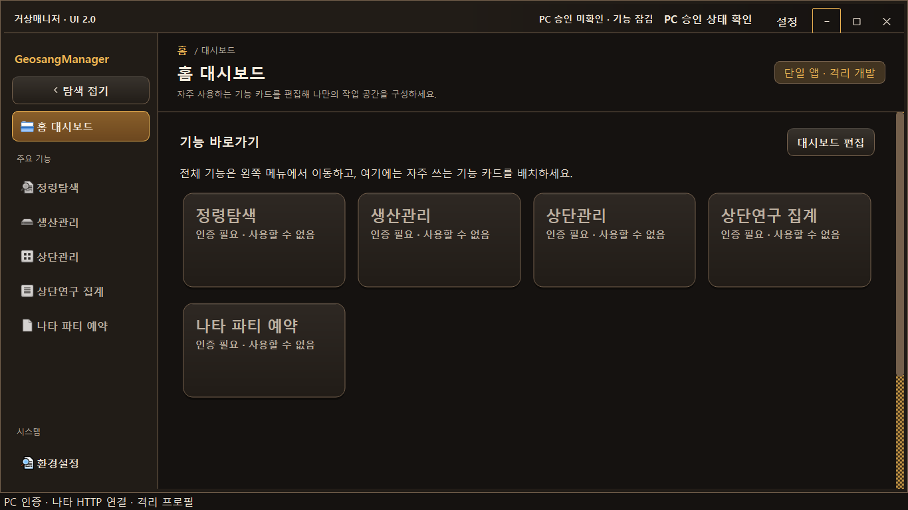

*그림 1. 인증 전 메인 화면. 왼쪽 기능이 잠겨 있어도 신청 화면은 상단 버튼으로 열 수 있습니다.*

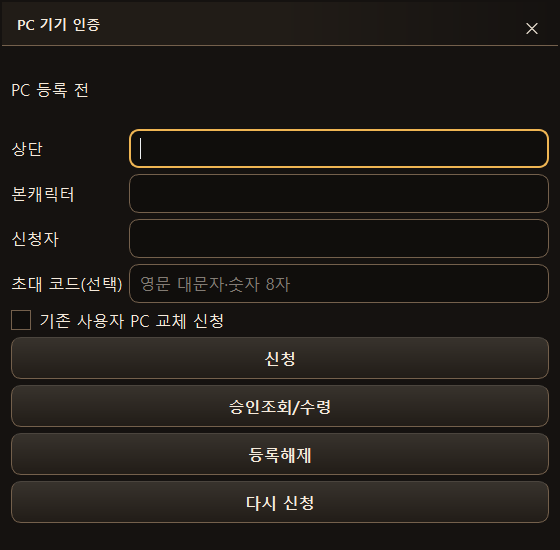

*그림 2. 신청 화면 전체. 위쪽은 현재 상태, 가운데는 신청 정보, 아래쪽은 네 가지 작업 버튼입니다.*

오류가 발생하면 별도의 **`PC 인증 안내` 팝업**이 나타납니다. 입력 화면 위쪽에는 오류 원문 대신 현재 상태만 표시됩니다. 팝업을 닫은 뒤에는 아래의 문제 해결 표를 참고하세요.

### 0.4 입력 항목과 버튼 이해하기

| 입력 항목 | 무엇을 입력하나요? | 확인할 점 |
|---|---|---|
| 상단 | 등록 대상 상단 이름 | 운영자에게 안내받은 표기대로 입력 |
| 본캐릭터 | 대표로 사용할 본캐릭터 이름 | 부캐릭터를 임의로 대신 넣지 말고 등록된 본캐릭터를 확인 |
| 신청자 | 운영자에게 등록된 신청자 이름 | 어떤 이름을 써야 하는지 모르면 운영자에게 확인. 임의의 닉네임이나 예시 이름을 넣지 않음 |
| 초대 코드(선택) | 운영자가 별도로 전달한 8자리 코드 | 영문 대문자·숫자만 사용. 없으면 빈칸 |
| 기존 사용자 PC 교체 신청 | 기존 활성 PC를 새 PC로 바꿀 때 체크 | 최초 등록 시에는 체크하지 않음 |

초대 코드를 소문자로 입력하면 자동으로 대문자로 바뀝니다. 하이픈·공백·한글을 넣지 마세요. 8자 형식이 맞아도 자동승인이 보장되는 것은 아닙니다. 코드는 다른 사람에게 공유하지 말고, 안내를 위한 화면을 보낼 때에도 가려 주세요.

| 버튼 | 언제 누르나요? | 결과와 주의사항 |
|---|---|---|
| 신청 | 정보를 입력하고 최초 등록 또는 PC 교체를 요청할 때 | 신청 접수. 다시 누르기 전에 현재 신청 상태를 먼저 확인 |
| 승인조회/수령 | 운영자 승인 여부를 확인하고 승인된 인증정보를 받을 때 | 승인됐으면 수령·확인 절차를 진행. 대기 중이면 대기 상태 표시 |
| 등록해제 | 더 이상 이 PC에서 사용하지 않으려 할 때 | 확인창이 나타남. 일반적인 앱 종료나 승인 조회용 버튼이 아님 |
| 다시 신청 | 잘못된 신청을 정리하거나 새 신청을 준비해야 할 때 | 확인 후 이 PC의 기존 인증 파일을 **백업 없이 삭제**. 아래 0.10을 먼저 읽음 |

### 0.5 최초 등록 신청하기

1. `[상단]`에 본인의 상단 이름을 입력합니다.
2. `[본캐릭터]`에 등록된 본캐릭터 이름을 입력합니다.
3. `[신청자]`에 운영자가 확인할 수 있는 등록 이름을 입력합니다.
4. 초대 코드를 받았다면 `[초대 코드(선택)]`에 입력합니다. 받지 않았다면 빈칸으로 둡니다.
5. **`[기존 사용자 PC 교체 신청]`은 체크하지 않습니다.**
6. 오타·띄어쓰기·다른 캐릭터 이름을 넣지 않았는지 확인합니다.
7. `[신청]`을 한 번 누릅니다.
8. 처리가 끝나 현재 상태가 바뀔 때까지 기다립니다. 처리 중에는 버튼을 반복해서 누르지 않습니다.

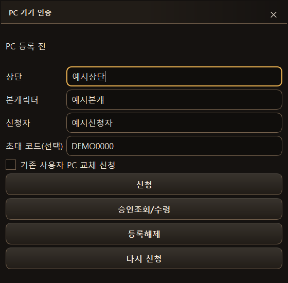

*그림 3. 최초 등록 입력 예시. `DEMO0000`은 화면 설명용 예시이며 실제 사용할 수 있는 초대 코드가 아닙니다.*

신청을 전송하면 신청자·초대 코드 입력란이 비워질 수 있습니다. **입력란이 비워졌다고 신청이 취소된 것은 아닙니다.** 상단의 현재 상태와 안내 팝업을 확인하세요.

신청 직후에는 다음 두 가지 흐름 중 하나로 진행됩니다.

| 신청 결과 | 다음 행동 |
|---|---|
| 운영자 승인 대기 중 | 운영자의 심사를 기다리고 `[승인조회/수령]`으로 확인 |
| 초대 코드 자동승인이 완료됨 | 앱이 기존 승인 조회·수령 절차를 이어서 진행. 최종 `PC 인증 완료` 확인 |

### 0.6 초대 코드를 사용한 경우

초대 코드는 **최초 등록에서만** 사용합니다. PC 교체 신청에서는 입력란이 비활성화되며 사용하지 않습니다.

유효한 코드이고 상단·본캐릭터·신청자 정보가 서버에 등록된 내용과 맞으면 운영자 수동 심사를 기다리지 않고 진행할 수 있습니다. 중간에 `신청 승인 완료 · 인증 수령 대기`나 `인증 수령 확인 중`이 잠깐 보일 수 있습니다. **최종적으로 `PC 인증 완료`가 표시되어야 끝난 것입니다.**

다음 경우에는 자동승인되지 않고 수동 승인 대기로 접수될 수 있습니다.

- 코드가 틀렸거나 만료·사용된 경우
- 상단·본캐릭터·신청자 정보가 등록된 정보와 맞지 않는 경우

이때 앱에 `자동승인이 완료되지 않았습니다. 운영자의 승인을 기다려 주세요.`라는 안내가 나올 수 있습니다. 서버는 어떤 항목이 틀렸는지 구분해서 알려 주지 않으므로, 코드나 이름을 추측해서 반복 신청하지 말고 운영자에게 확인하세요.

형식 자체가 잘못됐다면 `초대 코드는 영문 대문자와 숫자로 된 8자리입니다.`라는 안내를 확인하고 입력을 고칩니다. **초대 코드가 포함된 신청을 같은 인터넷 접속 주소에서 10분 동안 10회 넘게 보내면 요청이 제한될 수 있습니다.** 다른 일반적인 요청 제한도 있으므로, 코드 없이 무제한으로 재시도할 수 있다는 뜻은 아닙니다.

### 0.7 운영자 승인 기다리기

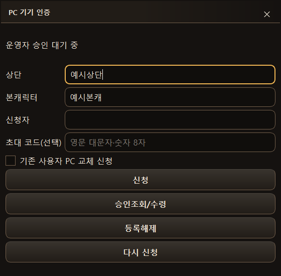

*그림 4. `운영자 승인 대기 중`은 접수됐지만 아직 인증을 사용할 수 없다는 뜻입니다.*

1. 신청 정보가 맞는지 확인한 뒤 운영자의 심사를 기다립니다.
2. 필요하면 운영자에게 **상단·본캐릭터·신청자·대략적인 신청 시각**을 알려 주세요. 비밀번호·인증 파일은 보내지 않습니다.
3. 창이 열린 상태에서는 앱이 대기 상태를 약 10초 간격으로 확인합니다.
4. 창을 닫아도 서버 신청이 취소되지는 않습니다. 다만 그 창의 자동 조회는 멈춥니다.
5. 나중에 다시 `[PC 승인 상태 확인]`을 열고 `[승인조회/수령]`을 누르면 됩니다. 앱 재실행 시에도 저장된 신청 복원을 시도합니다.

**심사에는 신청 시각부터 7일의 기한이 있습니다.** 이 기간에 승인이 완료돼야 합니다. 운영자 사정에 따라 승인까지 걸리는 시간은 달라지므로, 앱에서 임의의 승인 시각을 보장하지 않습니다.

`승인 상태는 10초 간격으로 확인할 수 있습니다.`라는 팝업이 나오면 최소 10초를 기다렸다가 다시 확인하세요. `[신청]`이나 `[다시 신청]`으로 바꿔 누를 필요는 없습니다.

### 0.8 승인된 인증정보 수령하기

운영자가 승인했다는 안내를 받았다면 **신청했던 PC에서** 다음과 같이 진행합니다.

1. 앱을 실행합니다.
2. `[PC 승인 상태 확인]`을 누릅니다.
3. `[승인조회/수령]`을 한 번 누릅니다.
4. 앱이 승인 상태를 확인하고 인증정보를 수령할 때까지 기다립니다.
5. 수령 확인이 끝나면 창 위쪽에 **`PC 인증 완료`**가 표시되는지 확인합니다.
6. 인증 창을 닫고 메인 화면 위쪽의 **`PC 인증 확인됨`**을 확인합니다.
7. 정령탐색·생산관리·나타 파티 예약 메뉴를 이용합니다.

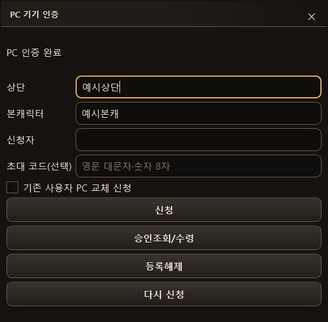

*그림 5. `PC 인증 완료`가 최종 완료 상태입니다. 승인 대기·수령 대기와 구분하세요.*

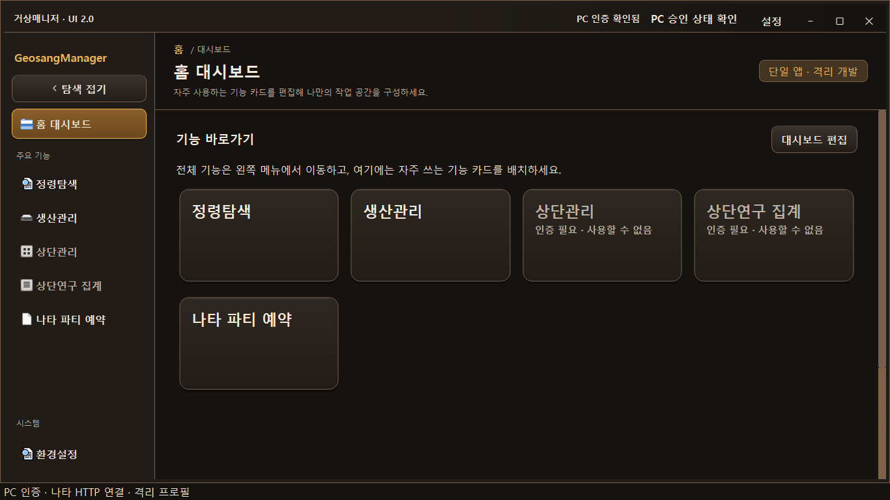

*그림 6. PC 인증이 끝나면 일반 사용자 기능이 활성화됩니다. 관리자 기능은 별도 권한이 없으면 계속 잠깁니다.*

**승인 후 수령 기한은 승인 시각부터 별도로 7일입니다.** 신청부터 심사까지의 7일과 같은 기한이 아닙니다. 승인을 받은 뒤에도 수령하지 않은 채 오래 두지 마세요.

앱은 수령 후 서버 확인까지 자동으로 이어서 처리합니다. 수령을 시작한 뒤 통신이 끊겼다면 앱을 다시 실행해 복원을 시도하고, 화면 안내에 따라 승인조회/수령을 진행하세요. 수령 후 약 10분 안에 확인이 끝나지 않으면 재신청이 필요할 수 있습니다. **인증 파일을 먼저 삭제하지 말고 현재 안내를 확인하세요.**

### 0.9 기존 PC를 새 PC로 교체하기

PC 교체는 **새로 사용할 PC에서** 신청합니다. 이미 등록된 사용자가 단순히 새 PC에서 최초 등록을 반복하는 절차가 아닙니다.

1. 새 PC에 거상매니저를 설치하고 실행합니다.
2. `[PC 승인 상태 확인]`을 엽니다.
3. 기존 등록과 같은 상단·본캐릭터·신청자 정보를 입력합니다.
4. **`[기존 사용자 PC 교체 신청]`을 체크합니다.**
5. 초대 코드 입력란이 비활성화되는지 확인합니다. 교체에는 초대 코드를 사용하지 않습니다.
6. `[신청]`을 누릅니다.
7. 운영자에게 PC 교체 신청임을 알리고 승인을 기다립니다.
8. 승인 후 **새 PC에서** `[승인조회/수령]`을 눌러 `PC 인증 완료`까지 진행합니다.

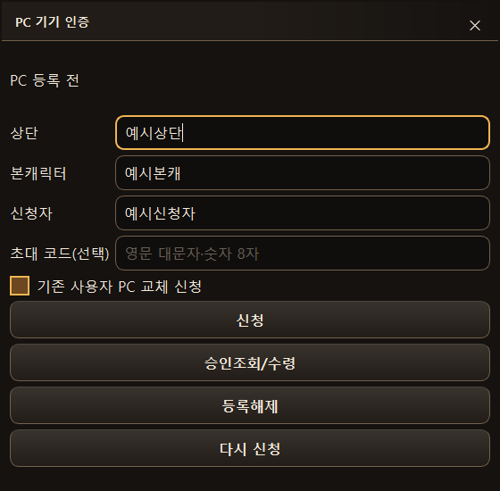

*그림 7. PC 교체 신청. 최초 등록과 달리 체크박스를 선택하며 초대 코드는 사용할 수 없습니다.*

교체 신청이나 승인만으로 곧바로 기존 PC가 폐기되는 것은 아닙니다. **새 PC의 인증 수령 확인이 정상 완료되는 시점에** 새 PC가 활성화되고 기존 PC 인증이 폐기됩니다. 새 PC에서 수령을 마치지 못했다면 기존 PC가 이미 폐기됐다고 단정하지 말고 운영자에게 확인하세요.

새 PC 인증이 완료되면 기존 PC에서는 더 이상 같은 PC 인증을 사용할 수 없습니다. 한 사용자의 활성 PC를 동시에 여러 대로 늘리는 절차는 아닙니다. **PC 교체는 게임 데이터나 로컬 사냥 기록을 새 PC로 복사하는 기능도 아닙니다.** 로컬 DB를 옮기는 작업은 별도로 확인해야 합니다.

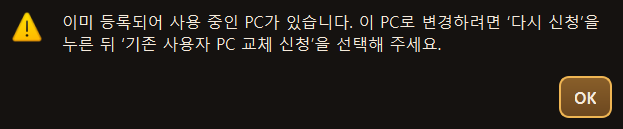

*그림 8. 이미 사용 중인 PC가 있다는 안내. 새 PC를 쓰려는 상황이면 교체 신청을 사용합니다.*

### 0.10 `[다시 신청]`은 신중하게 사용하세요

`[다시 신청]`은 현재 이 PC에 저장된 인증 파일을 **백업 없이 삭제**하고 새로운 신청을 준비하는 기능입니다. 단순 새로고침·승인 조회 버튼이 아닙니다.

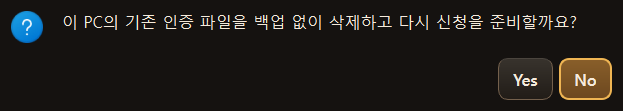

*그림 9. `다시 신청` 확인창. 삭제할 필요가 없다면 `[No]` 또는 닫기를 선택하세요. Windows 언어 설정에 따라 버튼 문구가 다를 수 있습니다.*

다음 사항을 먼저 확인하세요.

- 기존 인증·신청 정보를 더 이상 사용하지 않아도 되는 상황인가요?
- 단순 승인 대기나 일시적인 통신 오류라면 `[승인조회/수령]` 또는 앱 재실행으로 확인했나요?
- 활성 PC가 이미 있다면 최초 등록이 아니라 교체 신청을 해야 하는 상황인가요?
- 처리 중인 서버 신청을 운영자가 정리해야 하는 상황은 아닌가요?

정말 필요한 경우에만 다음 순서로 진행합니다.

1. `[다시 신청]`을 누릅니다.
2. `기존 인증 파일을 백업 없이 삭제`한다는 안내를 읽습니다.
3. 삭제 후 새 신청을 준비해도 된다면 `[Yes]`를 선택합니다. 필요 없다면 `[No]`를 선택합니다.
4. `PC 등록 전` 상태로 돌아왔는지 확인합니다.
5. 상단·본캐릭터·신청자를 다시 확인합니다. 남아 있는 입력 내용이 정확한지도 확인합니다.
6. 활성 PC가 없다면 교체 체크를 해제한 **최초 등록**, 기존 PC를 바꾸는 경우에는 **교체 신청**을 선택합니다.
7. `[신청]`을 누릅니다.

**이 버튼은 로컬 인증 파일을 삭제할 뿐, 서버의 진행 중 신청이나 활성 PC를 자동으로 취소하지 않습니다.** 따라서 삭제 후에도 같은 PC의 처리 중 신청이 남아 있으면 새 신청이 막힐 수 있습니다. 이때 파일을 반복 삭제하지 말고 운영자에게 기존 신청 확인·철회를 요청하세요.

이 작업은 정령탐색·생산관리 DB를 지우는 기능은 아닙니다. 다만 인증 파일을 삭제하면 이 PC에서 다시 인증을 마쳐야 기능을 사용할 수 있습니다.

### 0.11 PC 등록 해제하기

더 이상 이 PC를 사용하지 않을 때에만 `[등록해제]`를 사용합니다. 앱 창을 닫거나 PC를 재부팅하려는 이유만으로 누르지 마세요.

1. `[PC 승인 상태 확인]`을 엽니다.
2. `[등록해제]`를 누릅니다.
3. `이 PC를 폐기하면 재승인이 필요합니다. 해제할까요?`라는 안내를 확인합니다.
4. 계속 사용하려면 `[No]`를 선택합니다.
5. 정말 해제하려면 `[Yes]`를 선택하고 처리가 끝날 때까지 기다립니다.
6. 완료 후 `PC 등록 해제됨` 상태를 확인합니다. 이후 다시 사용하려면 재신청·승인이 필요합니다.

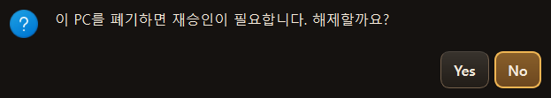

*그림 10. 등록 해제 확인창. 일반적인 프로그램 종료와 다릅니다.*

해제 도중 연결이 끊겨 `등록 해제 확인 대기 중`이 나오면 서버에서 해제가 끝났는지 아직 확실하지 않은 상태입니다. 앱은 복구를 위해 필요한 인증정보를 보관하고 재실행 시 해제 상태를 다시 확인합니다. 이때 파일을 지우거나 새 신청을 반복하지 말고, 인터넷 연결 후 앱을 다시 실행해 확인하세요. 해결되지 않으면 운영자에게 문의합니다.

### 0.12 신청 철회·거절·만료 이후 재신청

| 화면 상태 | 뜻 | 다음 행동 |
|---|---|---|
| 신청 거절됨 | 운영자가 신청을 승인하지 않음 | 정보와 사유를 운영자에게 확인한 뒤 필요하면 다시 신청 |
| 신청 승인 취소됨 | 기존 신청이 철회되어 사용할 수 없음 | 철회 안내를 확인하고 새 신청 준비 |
| 신청 또는 수령 기한 만료 | 심사 또는 수령 가능한 기간이 지남 | 다시 신청으로 새 절차 준비 |
| PC 인증 사용 중지 | 폐기·차단 등으로 기존 인증을 사용할 수 없음 | 운영자 확인 후 상황에 맞게 최초 등록 또는 교체 신청 |

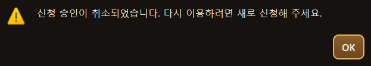

*그림 11. 신청 철회 안내 예시. 상태 조회·수령에서 서버가 신청 철회를 확인해 주면 앱은 저장된 신청 정보를 정리합니다.*

철회된 신청 정보가 자동으로 정리되고 최초 등록 상태로 돌아왔다면, 교체 체크 여부를 확인한 뒤 새 정보를 작성하여 `[신청]`합니다. 화면에 이전 신청이 남았다는 안내가 계속 나오면 운영자에게 확인한 후 `[다시 신청]`을 사용합니다.

자진 등록 해제·운영자 기기 폐기·사용자 철회 후 **사용 가능한 활성 PC가 없는 경우에는 교체 체크 없이 최초 등록으로 다시 신청**할 수 있습니다. 반대로 아직 활성 PC가 남아 있다면 교체 신청이 필요합니다. 거절·폐기의 사유 자체를 앱에서 임의로 우회할 수는 없습니다.

### 0.13 자주 나오는 안내와 해결 방법

오류 팝업은 확인 후 닫아도 됩니다. 입력 화면의 현재 상태를 함께 보고 아래 표의 행동을 선택하세요.

| 안내 문구 또는 상황 | 사용자가 할 일 |
|---|---|
| 상단, 본캐릭터, 신청자 정보를 모두 입력해 주세요 | 세 필수 입력란의 빈칸을 채운 뒤 신청 |
| 초대 코드는 영문 대문자와 숫자로 된 8자리입니다 | 코드 길이·공백·하이픈·한글 여부 확인. 코드가 없으면 빈칸 |
| 자동승인이 완료되지 않았습니다 | 운영자 승인 대기 상태를 유지하고 운영자에게 입력 정보 확인 |
| 이전 신청이 남아 있습니다 | 먼저 승인조회/수령. 무조건 다시 신청하지 않음 |
| 이 PC에 처리 중인 신청이 있습니다 | 서버에 열린 신청이 있음. 상태 확인 또는 운영자 문의. 로컬 파일 삭제만으로 해결되지 않을 수 있음 |
| 이미 등록되어 사용 중인 PC가 있습니다 | 새 PC를 쓰려는 상황이면 교체 신청. 활성 PC가 없어야 한다고 생각되면 운영자 확인 |
| 아직 인증정보를 받을 수 없습니다 | 아직 승인되지 않았거나 신청이 무효화된 상태일 수 있음. 운영자 확인 및 상태 조회 |
| 이미 인증정보를 받은 신청입니다 | 먼저 앱 재실행으로 저장 인증 복원 확인. 계속되면 운영자 문의 |
| 승인 상태는 10초 간격으로 확인할 수 있습니다 | 최소 10초 기다린 뒤 다시 조회 |
| 요청이 많습니다. ○초 후 다시 시도해 주세요 | 안내된 시간만큼 기다림. 코드·이름을 바꿔 요청을 반복하지 않음 |
| 인증을 완료할 수 있는 기간이 지났습니다 | 심사·수령 기한 확인 후 다시 신청 |
| 신청 승인이 취소되었습니다 | 철회 안내를 확인하고 새 신청 준비 |
| 인증정보의 안전을 확인할 수 없어 사용이 중지되었습니다 | 인증 파일 복사·재사용을 멈추고 운영자에게 문의 |
| 저장된 인증정보를 읽을 수 없습니다 | 같은 Windows 사용자로 앱 재실행. 해결되지 않으면 운영자 문의. 파일 내용을 채팅에 보내지 않음 |
| 현재 서버에서 사용할 수 없는 인증정보입니다 | 공식 운영 앱인지 확인. 테스트 프로필의 파일을 운영 폴더에 복사하지 않음 |
| 서버의 처리 결과를 확인하지 못했습니다 | 인터넷 확인 후 앱 재실행·승인조회/수령. 접수되지 않았다고 단정하지 않음 |
| 등록 해제가 완료되었는지 확인하지 못했습니다 | 인터넷 연결 후 재실행하여 해제 상태 복구. 인증 파일 임의 삭제 금지 |

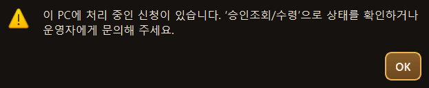

*그림 12. 새 신청을 반복하는 대신 기존 신청 상태를 확인해야 하는 경우입니다.*

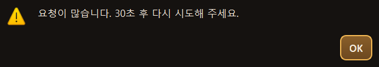

*그림 13. 요청 제한 안내. 그림의 30초는 예시이며 실제 팝업에 표시된 대기시간을 따르세요.*

### 0.14 인증 완료 후 알아둘 점

- **앱 종료는 PC 등록 해제가 아닙니다.** 정상 종료 후 다시 실행하면 저장된 PC 인증 복원을 시도합니다. 매번 새로 신청하지 마세요.
- 일반 사용자 기능은 온라인 PC 인증 상태를 확인합니다. 관리자에게 적용되는 72시간 오프라인 열람이나 저장 로그인 30일을 일반 사용자 PC 인증의 오프라인 사용 기한으로 생각하지 마세요. PC 인증과 관리자 로그인은 서로 다른 절차입니다.
- 서버 정책상 오랫동안 사용하지 않은 기기에는 만료 규칙이 적용됩니다. 90일 미사용 등으로 기존 인증을 사용할 수 없게 됐다면 운영자에게 확인하세요. 영구 사용을 보장하는 등록은 아닙니다.
- 업데이트·재설치만을 이유로 `[등록해제]`나 `[다시 신청]`을 누를 필요는 없습니다. 기존 Windows 사용자 데이터 폴더를 유지합니다.
- 인증 파일은 Windows 사용자 보호 기능으로 저장됩니다. 다른 PC·Windows 계정·테스트 폴더에서 복사해 인증을 옮기려고 하지 마세요. PC를 바꾸려면 교체 신청 절차를 사용합니다.
- 다른 사람에게 비밀번호·토큰·인증 파일을 보내지 마세요. 운영자 문의 시에는 현재 상태·대략적인 발생 시각·일반 안내 문구를 알려 주세요. 화면을 공유할 때 이름과 초대 코드도 필요한 범위만 남기고 가립니다.
- 관리자 기능만 잠겨 있다면 PC 인증을 반복하기 전에 관리자 권한이 필요한 메뉴인지 확인하세요. 일반 사용자에게 관리자 로그인을 필수로 요구하는 구조가 아닙니다.

## 1. 정령탐색으로 할 수 있는 일

정령탐색은 캐릭터가 사냥한 뒤의 아이템 보유량을 입력하여 획득량을 기록하는 기능입니다.

다음 작업을 할 수 있습니다.

- 캐릭터 등록과 닉네임 변경
- 캐릭터·속성별 아이템 보유량 관리
- 단일 속성 또는 혼합 속성 사냥 기록
- 판매·사용한 아이템 수량 반영
- 캐릭터 사이 아이템 이전 기록
- 잘못 입력한 최신 사냥 기록 수정
- 날짜·기간·월별 획득량 조회

게임 안의 사냥·판매·아이템 이전은 사용자가 직접 진행합니다. 앱이 게임을 자동으로 조작하지는 않습니다.

## 2. 가장 먼저 알아둘 입력 원칙

입력하는 값은 오늘 얻은 개수가 아니라 **현재 총 보유량**입니다.

예를 들어 정령석을 원래 100개 가지고 있었고, 사냥 후 115개가 되었다면 입력할 값은 15가 아니라 115입니다. 앱이 이전 기준 100개와 비교하여 획득량 15개를 계산합니다.

| 구분 | 예시 |
|---|---:|
| 사냥 전 기준 보유량 | 100개 |
| 사냥 후 입력할 총 보유량 | 115개 |
| 앱이 계산하는 획득량 | 15개 |

또한 사냥하지 않은 캐릭터는 참여 체크를 해제해야 합니다. 참여 상태에서 보유량을 그대로 저장하면 ‘사냥했지만 획득은 0개’인 기록으로 남습니다.

## 3. 처음 사용하는 경우

### 3.1 캐릭터 등록

1. 메인 화면에서 `[정령탐색]`을 엽니다.
2. `[캐릭터 관리]`를 누릅니다.
3. `[신규]`를 선택합니다.
4. 캐릭터 닉네임과 주 속성을 입력합니다.
5. 해당 속성의 현재 아이템 보유량을 입력합니다.
6. 내용을 확인하고 등록합니다.

관리하는 아이템은 다음 네 종류입니다.

| 항목 | 입력 내용 |
|---|---|
| 정령옥 | 현재 가지고 있는 정령옥 수량 |
| 정령석 | 현재 가지고 있는 정령석 수량 |
| 구슬조각 | 현재 가지고 있는 구슬조각 수량 |
| 속성석 | 현재 가지고 있는 속성석 수량 |

시작 보유량은 등록 이후의 획득량을 계산하는 기준입니다. 이미 가지고 있던 아이템이 있다면 실제 수량을 넣어야 합니다.

### 3.2 기존 데이터를 이관받은 경우

캐릭터가 이미 등록되어 있다면 다시 등록하지 않습니다.

첫 사냥을 기록하기 전에 다음 내용을 확인하세요.

- 캐릭터 목록이 맞는지
- 속성과 보유량이 실제 상태와 맞는지
- 과거에 기록하지 않았던 아이템이 임시 0으로 되어 있지 않은지

특히 과거에 정령옥을 기록하지 않았다면, 표시된 0이 실제 보유량을 뜻하지 않을 수 있습니다. 첫 사냥 전에 `[캐릭터 관리 → 수정 → 현재 보유량 수정]`에서 실제 시작 수량으로 맞추세요.

> 이미 보유한 정령옥이 50개라면 먼저 기준을 50으로 수정합니다. 그다음 사냥 후 53개를 입력하면 새로 얻은 3개만 집계됩니다.

## 4. 매일 사냥 기록하기

일반적인 입력 순서는 다음과 같습니다.

1. 사냥 일자를 확인합니다.
2. 오늘 사냥한 캐릭터만 참여 상태로 둡니다.
3. 사냥한 속성을 확인합니다.
4. 사냥 후 아이템 총 보유량을 입력합니다.
5. 필요한 경우 판매·사용량이나 혼합 속성을 추가 입력합니다.
6. `[기록 저장]`을 누릅니다.
7. 저장 완료 안내를 확인합니다.

저장된 보유량은 다음 사냥의 새 기준으로 사용됩니다.

### 4.1 사냥 일자

기본값은 PC의 오늘 날짜입니다.

- 오늘 기록은 그대로 입력하면 됩니다.
- 미래 날짜는 저장할 수 없습니다.
- 과거 날짜는 그 날짜보다 뒤의 기록이 없을 때만 입력할 수 있습니다.
- 선택할 수 없는 날짜라면 사유가 안내되고 오늘로 돌아갑니다.

과거 날짜를 선택할 수 있다고 해서 오래된 기록을 자유롭게 수정할 수 있는 것은 아닙니다.

### 4.2 참여 체크

| 실제 상황 | 처리 |
|---|---|
| 사냥했고 아이템을 얻음 | 참여 체크 후 총 보유량 입력 |
| 사냥했지만 얻은 아이템이 없음 | 참여 체크 유지, 실제 보유량 그대로 입력 |
| 사냥하지 않음 | 참여 체크 해제 |

사냥하지 않은 캐릭터를 참여 상태로 저장하면 진행 횟수와 평균에 영향을 줄 수 있습니다.

### 4.3 캐릭터 검색

이름 일부를 검색하여 원하는 캐릭터를 찾을 수 있습니다.

검색은 화면에 보이는 목록만 줄입니다. 검색으로 숨겨진 캐릭터도 참여 상태라면 함께 저장됩니다. 일부 캐릭터만 기록하려면 검색뿐 아니라 참여 체크도 확인하세요.

## 5. 한 가지 속성으로 사냥한 경우

한 캐릭터가 한 가지 속성으로만 사냥했다면 기본 입력 화면에서 해당 속성과 총 보유량을 입력합니다.

단일 속성은 캐릭터별 한 저장 묶음에서 3회 진행한 것으로 자동 기록됩니다. 횟수를 따로 수정하지 않습니다.

예를 들어 캐릭터 A와 B가 모두 불 속성 단일 사냥을 기록하면 진행 횟수는 각각 3회, 합계 6회입니다.

## 6. 여러 속성으로 나누어 사냥한 경우

한 캐릭터가 여러 속성으로 나누어 진행했다면 추가 입력창을 사용합니다.

1. 해당 캐릭터의 추가 입력창을 엽니다.
2. 진행한 다른 속성을 추가합니다.
3. 각 속성의 참여 여부를 확인합니다.
4. 속성별 사냥 후 총 보유량을 입력합니다.
5. 각 속성의 진행 횟수를 입력합니다.
6. 입력을 적용하고, 사냥 화면에서 `[기록 저장]`을 누릅니다.

추가 입력창에서 적용한 것만으로는 최종 저장되지 않습니다.

### 횟수 입력 규칙

- 참여한 속성마다 1회 이상 입력해야 합니다.
- 캐릭터 한 명의 합계는 최대 3회입니다.
- 공란·0·음수·소수·문자는 입력할 수 없습니다.
- 횟수 모름은 지원하지 않습니다.
- 진행하지 않은 속성은 참여를 해제합니다.

| 입력 예시 | 저장 가능 여부 |
|---|---|
| 불 2회 + 물 1회 | 가능 |
| 불 1회 + 물 1회 + 땅 1회 | 가능 |
| 불 1회 + 물 1회 | 가능 |
| 불 3회 + 물 1회 | 불가 — 합계 4회 |

처음 기록하는 속성은 시작 기준이 0일 수 있습니다. 그 속성의 아이템을 이미 가지고 있었다면, 기존 보유분이 새 획득량으로 잡히지 않도록 사냥 전 기준을 확인하세요.

## 7. 기록 전에 아이템을 팔거나 사용한 경우

사냥한 뒤 기록하기 전에 아이템을 팔거나 사용했다면, 현재 남은 수량만 입력해서는 획득량을 정확히 계산할 수 없습니다.

이때는 판매·사용 입력을 함께 사용합니다.

### 입력 예시

| 내용 | 수량 |
|---|---:|
| 이전 기준 보유량 | 100개 |
| 사냥으로 얻은 수량 | 20개 |
| 기록 전에 판매한 수량 | 80개 |
| 현재 남은 보유량 | 40개 |

다음과 같이 입력합니다.

- 현재 보유량: `40`
- 판매·사용량: `80`

앱은 `40 + 80 - 100`으로 계산하여 획득량을 20개로 기록합니다. 다음 기준 보유량은 실제 남은 40개입니다.

### 주의사항

- 이미 기준 수량 조정으로 반영한 판매량을 다시 넣지 마세요.
- 캐릭터 사이에 옮긴 수량을 판매·사용량으로 중복 입력하지 마세요.
- 판매·사용이 없으면 해당 칸은 비워 두어도 됩니다.
- 계산 결과가 음수라면 보유량·판매량·이전 기준을 다시 확인하세요.

## 8. 캐릭터 사이에서 아이템을 옮긴 경우

게임에서 캐릭터 사이에 아이템을 옮겼다면 `[정산]`을 사용합니다.

정산은 사냥 획득이 아니라 보유량 이동입니다. 이전한 수량 자체는 획득 통계에 포함되지 않습니다.

### 8.1 전량이전

받는 캐릭터 한 명에게 다른 캐릭터들의 관리 중인 아이템을 모두 모을 때 사용합니다.

1. `[정산]`을 누릅니다.
2. `[전량이전]`을 선택합니다.
3. 받는 캐릭터를 선택합니다.
4. 변경 전후 수량을 확인합니다.
5. 실제 게임에서 옮긴 내용과 맞으면 확정합니다.

받는 캐릭터 외의 캐릭터가 가진 모든 관리 속성·아이템이 대상이므로, 확정 전에 이전 범위를 확인하세요.

### 8.2 선택이전

일부 캐릭터나 일부 아이템만 옮길 때 사용합니다.

1. `[정산 → 선택이전]`을 선택합니다.
2. 받는 캐릭터를 선택합니다.
3. 보낼 캐릭터·속성·아이템별 이전 수량을 입력합니다.
4. 미리보기에서 변경 내용을 확인합니다.
5. 확정합니다.

공란과 0은 이전하지 않습니다. 보유량보다 많은 수량은 이전할 수 없습니다.

받는 캐릭터에게 해당 속성의 기준이 없다면, 원래 가지고 있던 수량을 확인하는 입력창이 나옵니다. 기존 보유량이 있다면 실제 수량을 입력하세요.

> 사냥으로 얻었지만 아직 기록하지 않은 수량을 정산만으로 사냥 이력에 남길 수는 없습니다. 미기록 사냥분과 단순 이전량을 혼동하지 마세요.

## 9. 현재 보유량만 맞추고 싶은 경우

게임의 실제 수량과 앱의 기준 수량을 맞추려면 다음 메뉴를 사용합니다.

`[캐릭터 관리 → 수정 → 현재 보유량 수정]`

1. 수정할 캐릭터를 선택합니다.
2. 조정할 속성을 선택합니다.
3. 실제 남은 총 보유량을 입력합니다.
4. 필요하면 사유·메모를 작성합니다.
5. 변경 전후 수량을 확인하고 확정합니다.

이 기능은 앞으로 사용할 기준만 바꿉니다.

| 항목 | 보유량 수정 시 처리 |
|---|---|
| 현재 기준 보유량 | 변경 |
| 과거 사냥 획득량 | 유지 |
| 획득 합계 | 조정분 미포함 |
| 진행일·진행 횟수 | 추가하지 않음 |

### 사냥 기록 수정과 구분하기

- 방금 저장한 사냥 수량을 잘못 입력했다면 `[최신 기록 수정]`을 사용합니다.
- 사냥 통계는 그대로 두고 현재 상태만 맞추려면 보유량 수정을 사용합니다.

미기록 사냥으로 얻은 수량까지 보유량 수정에 넣으면 그 획득은 통계에 남지 않습니다. 또한 보유량을 조정한 뒤에는 그보다 앞선 최신 사냥 기록을 수정할 수 없습니다.

## 10. 닉네임과 표시 순서 바꾸기

### 닉네임 변경

`[캐릭터 관리 → 수정 → 닉네임 수정]`에서 변경합니다.

기존 기록과 연결은 유지되며, 과거 기록을 다시 조회하면 새 닉네임으로 표시됩니다.

### 표시 순서 변경

`[캐릭터 순서 편집]`에서 순서를 조정하고 저장합니다.

검색을 해제하면 저장한 전체 순서를 기준으로 목록을 볼 수 있습니다.

## 11. 저장한 사냥 기록을 잘못 입력한 경우

`[최신 기록 수정]`은 마지막으로 저장한 일반 사냥 기록을 정정하는 기능입니다.

수정할 수 있는 항목은 다음과 같습니다.

- 사냥 일자
- 참여 캐릭터·속성
- 현재 총 보유량
- 판매·사용량
- 혼합 속성의 진행 횟수

변경 내용을 확인하고 확정하면 원래 사냥 기록과 연결된 현재 기준이 함께 갱신됩니다.

### 수정할 수 없는 경우

- 더 최근의 사냥 기록이 있는 경우
- 해당 기록 이후 정산을 한 경우
- 해당 기록 이후 보유량을 조정한 경우
- 엑셀에서 가져온 과거 이관 기록인 경우

다른 캐릭터를 정산하거나 보유량을 조정한 경우에도 이전 사냥 기록의 수정이 제한됩니다.

저장 기록 삭제·취소, 정산 되돌리기, 오래된 기록의 연쇄 수정은 지원하지 않습니다. 수정이 잠긴 상태에서 현재 수량만 맞춰야 한다면 보유량 수정 기능을 사용하세요.

## 12. 기록과 통계 조회하기

| 탭 | 사용하는 상황 |
|---|---|
| 사냥 기록 | 오늘 사냥 결과 입력 |
| 기간별 상세 | 시작일과 종료일 사이의 기록 확인 |
| 일자별 상세 | 특정 날짜의 기록 확인 |
| 월별 집계 | 월별·속성별·아이템별 합계와 평균 확인 |

기간 조회에는 시작일과 종료일이 모두 포함됩니다.

### 통계 항목의 의미

| 항목 | 의미 |
|---|---|
| 획득 합계 | 기록된 사냥 획득량의 합계 |
| 진행일 | 해당 아이템의 기록이 있는 서로 다른 날짜 수 |
| 캐릭터 진행 횟수 | 기록된 캐릭터별 진행 횟수의 합계 |
| 일일 평균 | 획득 합계 ÷ 진행일 |
| 진행당 평균 | 횟수가 확인된 기록의 획득 합계 ÷ 같은 기록의 진행 횟수 |

사냥했지만 획득이 0개인 날도 진행일에 포함됩니다. 정산과 보유량 조정은 사냥 통계에 포함되지 않습니다.

### 과거 이관 기록이 다르게 보이는 이유

이전 자료에 없던 정보는 임의로 만들지 않습니다.

- 개인별 정보가 없으면 과거 합산 기록으로 표시됩니다.
- 진행 횟수가 없으면 진행당 평균 계산에서 제외됩니다.
- 정령옥을 기록하지 않았던 기간은 정령옥의 0획득 기간으로 처리하지 않습니다.
- 평균을 계산할 수 없으면 대시가 표시됩니다.
- 일부 미기록 상세 값은 `None`으로 보일 수 있으며, 이는 실제 수량 0과 다릅니다.

## 13. 자주 겪는 상황

| 상황 | 확인할 내용 |
|---|---|
| 획득량이 예상보다 크게 나옴 | 처음 기준을 실제 수량으로 맞췄는지, 획득량 대신 총 보유량을 입력했는지 확인 |
| 음수 획득 오류가 나옴 | 판매·사용량 누락, 총 보유량 오입력, 기준 수량 불일치 확인 |
| 검색한 캐릭터 외에도 저장됨 | 검색은 표시만 제한함. 저장 대상은 참여 체크로 결정 |
| 사냥하지 않은 캐릭터가 0획득으로 기록됨 | 참여 체크를 해제했는지 확인 |
| 정산·관리 버튼을 사용할 수 없음 | 저장하지 않은 사냥 입력이 있는지 확인 |
| 최신 기록 수정이 막힘 | 이후 사냥·정산·보유량 조정 여부 확인 |
| 정령옥의 과거 평균이 표시되지 않음 | 과거에 정령옥을 기록하지 않았다면 정상적인 미기록 처리 |
| 프로그램을 새 폴더로 옮겨도 기존 데이터가 보임 | 데이터는 프로그램 폴더와 별도로 저장됨 |

## 14. 데이터 백업과 프로그램 업데이트

프로그램을 업데이트하기 전에는 앱을 종료하고 데이터를 백업하세요.

Windows 기본 정령탐색 데이터 위치는 다음과 같습니다.

```text
%LOCALAPPDATA%\GeosangManager\spirit_search.sqlite3
```

업데이트할 때는 다음 원칙을 지킵니다.

1. 실행 중인 거상매니저를 모두 종료합니다.
2. 현재 사용 중인 DB를 별도 위치에 복사해 둡니다.
3. 설치형은 새 `Setup.exe`로 설치합니다. ZIP 사용자는 배포 폴더 전체를 교체합니다.
4. 사용 중인 DB는 그대로 유지합니다.

초기 이관 DB를 다시 덮어쓰면 이후 쌓인 기록을 잃을 수 있습니다. 처음 적용한 뒤에는 계속 사용 중인 DB를 보존하세요.

같은 데이터를 사용하는 프로그램을 동시에 실행해 편집하지 마세요.
